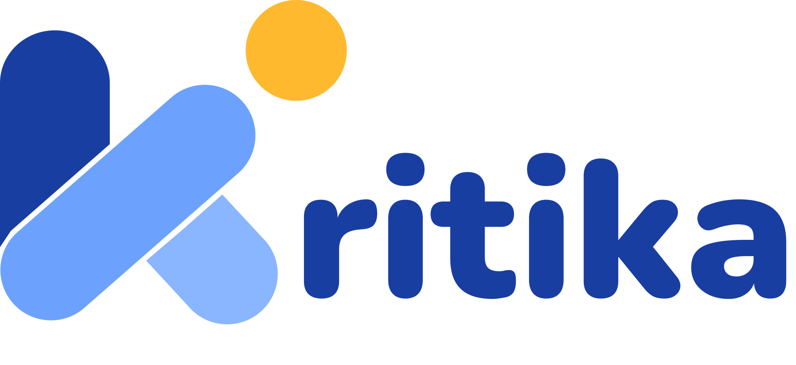

  

  
"Baca, Tautkan, Buktikan"

---

## Tentang Kritika

Kritika adalah aplikasi web berbasis Next.js dan TypeScript yang dirancang untuk membantu siswa SD akhir hingga SMP mengembangkan pemahaman bacaan dan kemampuan berpikir kritis.

Melalui konsep *Evidence Detective Mission*, materi pembelajaran dikemas menjadi misi investigasi. Siswa membaca teks, menemukan informasi penting, menyusun hubungan antara klaim, bukti, sebab, dan akibat melalui blok visual, lalu menguji apakah suatu klaim benar-benar didukung oleh teks.

Bagi guru, Kritika membantu menyiapkan aktivitas pembelajaran dengan dukungan AI dan menampilkan pola kesalahan siswa. Dengan demikian, guru tidak hanya melihat jawaban akhir, tetapi juga hubungan alasan dan bukti yang dibangun siswa.

## Fitur Utama

### 1. AI Assignment Generator

Mengubah materi yang diunggah guru menjadi draft misi, blok pembelajaran, dan tantangan logika. Guru dapat meninjau serta mengedit hasil AI sebelum assignment dipublikasikan.

### 2. Visual Evidence Chain

Membantu siswa menyusun blok klaim, bukti, sebab, dan akibat secara visual. Setiap hubungan yang dibuat mendorong siswa untuk menjelaskan alasan berdasarkan informasi dalam teks, bukan sekadar menebak jawaban.

### 3. Logic Trap Challenge

Mengajak siswa mengevaluasi klaim yang terlalu luas, tidak cukup didukung, atau bertentangan dengan teks. Siswa menerima umpan balik untuk meninjau dan memperbaiki penalarannya.

### 4. Teacher Insight Dashboard

Menyajikan progres pengerjaan, skor, dan pola kesalahan siswa per assignment, seperti kesulitan memilih bukti atau menghubungkan sebab dan akibat. Informasi ini membantu guru menentukan tindak lanjut pembelajaran.

---

## Teknologi & Dependensi

### Framework & Runtime

| Teknologi | Versi | Keterangan |
|---|---|---|
| [Next.js](https://nextjs.org) | 16.3.6 | App Router, SSR, file-based routing |
| [React](https://react.dev) | 19.2.8 | UI library utama |
| [TypeScript](https://www.typescriptlang.org) | ^5 | Type safety di seluruh codebase |

### Dependencies

| Package | Versi | Keterangan |
|---|---|---|
| [@xyflow/react](https://xyflow.com) | ^12.12.0 | Node-based diagram untuk Visual Evidence Chain |
| [framer-motion](https://www.framer.com/motion) | ^14.3.0 | Animasi dan transisi halaman landing |
| [lucide-react](https://lucide.dev) | ^1.55.0 | Icon set konsisten di seluruh UI |

### Dev Dependencies

| Package | Versi | Keterangan |
|---|---|---|
| [Tailwind CSS](https://tailwindcss.com) | ^4 | Utility-first CSS framework |
| [@tailwindcss/postcss](https://tailwindcss.com) | ^4 | PostCSS plugin untuk Tailwind v4 |
| [ESLint](https://eslint.org) | ^9 | Linting dengan konfigurasi Next.js |

---

## Tipografi & Desain

### Tipografi

| Peran | Font | Keterangan |
|---|---|---|
| **Font Utama (body & UI)** | [Guton](public/fonts/) | Font custom lokal, tersedia dalam 6 weight: Regular (400), Medium (500), SemiBold (600), Bold (700), ExtraBold (800), Black (900) |
| **Font Fallback** | Geist Sans | Font Google via `next/font`, dimuat sebagai CSS variable `--font-geist-sans` |
| **Font Monospace** | Geist Mono | Font Google via `next/font`, dimuat sebagai CSS variable `--font-geist-mono` |

### Palet Warna

| Token | Nilai | Penggunaan |
|---|---|---|
| `--primary` | `#1d4ed8` | Tombol utama, aksen biru |
| `--primary-hover` | `#1e40af` | State hover tombol utama |
| `--background` | `#f7f7f7` | Latar belakang halaman |
| `--foreground` | `#0a0a0a` | Teks utama |
| `--muted` | `#6b7280` | Teks sekunder / placeholder |
| `--border` | `#9ca3af` | Garis batas input & komponen |
| `--panel-from` | `#3b82f6` | Warna awal panel kanan auth |
| `--panel-to` | `#1d4ed8` | Warna akhir panel kanan auth |

### Radius & Shadow

| Token | Nilai | Penggunaan |
|---|---|---|
| `--radius-field` | `0.5rem` | Input, select, textarea |
| `--radius-panel` | `2rem` | Panel gambar di halaman auth |
| `--shadow-glow` | `0 4px 16px rgba(29,78,216,0.35)` | Efek glow tombol primary |
---
Kritika dikembangkan untuk kebutuhan hackathon dengan tujuan menghadirkan pembelajaran membaca yang lebih aktif dan bermakna. Siswa tidak hanya menemukan jawaban, tetapi belajar menjelaskan mengapa jawaban tersebut dapat dipercaya.

---